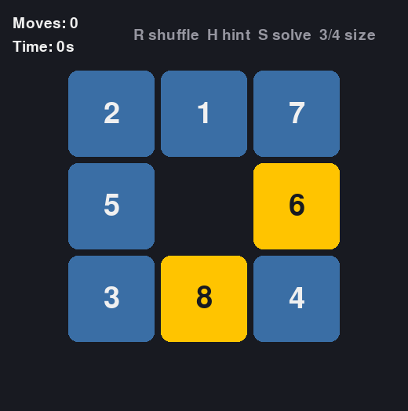
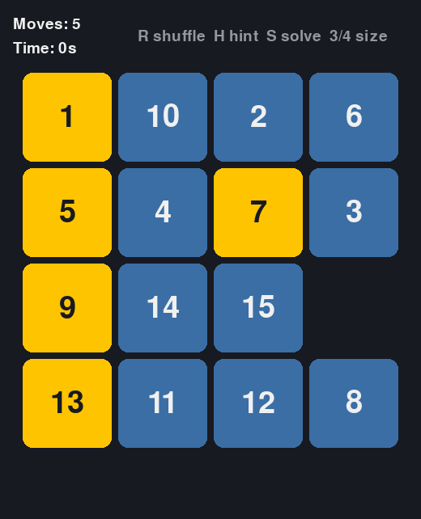
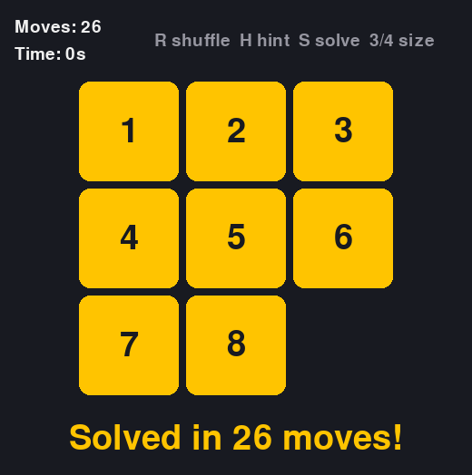
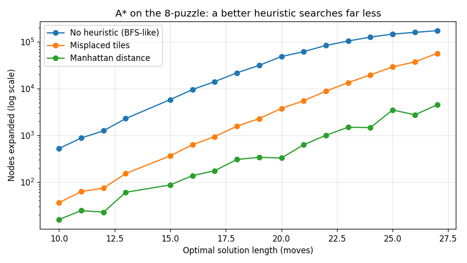

# Sliding Puzzle + A* Solver

**Quick summary:** A playable 8-puzzle / 15-puzzle game in Python (Pygame) with a built-in AI that solves any board with the A* search algorithm.



## Description
Tiles are shuffled; slide them into the empty space until they read 1 → N in order. Tiles already in their correct spot turn gold. Stuck? Press **H** for a hint or **S** to watch the solver finish the board.

Under the hood, the game logic (`puzzle.py`) is completely separate from the graphics (`game.py`), so the solver can be tested and benchmarked without opening a window.

| 4×4 mode | Solved by the AI |
|---|---|
|  |  |

## Tools Used
- **Python 3.10+**
- **Pygame**: rendering and input
- **heapq**: priority queue for A*
- **Matplotlib**: benchmark chart
- **pytest-style tests**: run with `pytest` or just `python test_puzzle.py`

## Scope
- 3×3 and 4×4 boards, mouse + keyboard controls, move counter, timer
- Solver: A* with three heuristics (none, misplaced tiles, Manhattan distance)
- Out of scope: online leaderboards, image-based puzzles

## Objective
Build a complete, playable game and use it to show understanding of search algorithms, data structures (priority queues, hash maps), and algorithmic efficiency, which are the same ideas behind route-finding in networks and attack-path analysis in security.

## Result
- Every shuffle is guaranteed solvable (random walk from the solved state, and a parity check proves it).
- The solver always finds the **shortest** solution on 3×3 boards.
- Heuristic choice matters a lot. Averaged over 60 random boards:

| Heuristic | Avg. nodes expanded |
|---|---|
| None (behaves like BFS) | 48,665 |
| Misplaced tiles | 7,736 |
| **Manhattan distance** | **768** (≈63× less work) |



## What I Learned
- **A\* search:** `f = g + h` (cost so far + estimated cost left). A heuristic that never overestimates keeps the answer optimal.
- **Why half of all boards are impossible:** swapping any two tiles flips the "inversion parity", and no legal move can flip it back.
- **Trade-offs:** on 4×4 the hint uses *weighted* A* (h × 1.6). It's much faster but not always the shortest. That's a real engineering choice between speed and optimality.
- Keeping logic separate from UI makes code testable.

## Run It
```bash
pip install -r requirements.txt
python game.py            # 3x3
python game.py --size 4   # 4x4
python test_puzzle.py     # tests
python bench.py           # regenerate the chart
```
Controls: click a tile or use the arrow keys · **R** reshuffle · **H** hint · **S** auto-solve · **3/4** switch size
